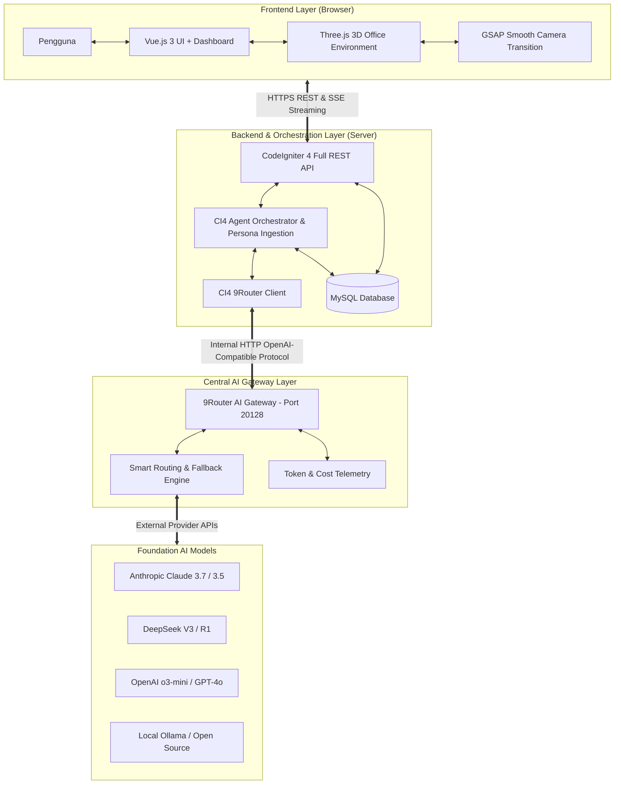

# DOKUMENTASI INDUK ARSITEKTUR DAN SPESIFIKASI TEKNIS
# KANTOR 3D (MCE-eOffice)
**Virtual Office Environment & Multi-Agent AI Ecosystem**

Versi Dokumen: 2.0 (Arsitektur Ramping Terintegrasi)  
Tanggal: 19 November 2026  
Status: Dokumen Arsitektur Resmi  
Platform: Web-based 3D Virtual Office  
Repositori: `https://github.com/mitracreativeenvironment-oss/MCE-eOffice`  

---

# BAB 1. PENDAHULUAN

## 1.1 Latar Belakang

Kantor 3D (MCE-eOffice) merupakan platform kantor virtual berbasis web yang menggabungkan visualisasi 3D interaktif dengan ekosistem kecerdasan buatan (*Artificial Intelligence*) berbasis multi-agen spesialis.

Kantor 3D tidak hanya berfungsi sebagai representasi visual digital, tetapi sebagai lingkungan kerja kolaboratif interaktif tempat pengguna dapat berkomunikasi, memberikan instruksi tugas, memantau kemajuan pekerjaan, dan menerima *deliverables* nyata dari puluhan agen AI spesialis (arsitek sistem, pengembang backend, analis basis data, penguji QA, perancang UI/UX, dan lainnya).

Sistem menggunakan arsitektur modular yang ramping, efisien, dan berlatensi rendah:
1. **Frontend 3D Visual (Vue.js 3 + Three.js + GSAP):** Rendering lingkungan kantor virtual, gedung multi-lantai, avatar karakter 3D, dan kontrol kamera sinematik.
2. **Backend & Agent Orchestrator (CodeIgniter 4 Full REST API + MySQL):** Menjadi pusat kendali aplikasi, autentikasi pengguna, manajemen hak akses (RBAC), siklus hidup agen, orkestrasi tugas, injeksi persona, dan penyimpanan riwayat obrolan.
3. **Central AI Gateway (9Router):** Menjadi satu-satunya pintu gerbang akses seluruh foundation model AI (Claude, DeepSeek, OpenAI, Gemini, Ollama) dengan kemampuan *smart model routing*, *automatic failover*, dan optimasi token.

## 1.2 Tujuan Pengembangan

1. Membangun lingkungan kantor virtual interaktif berbasis web 3D.
2. Menghadirkan avatar 3D yang memiliki status visual dinamis (*idle*, *listening*, *thinking*, *speaking*, *working*, *error*).
3. Mengadopsi ratusan persona agen profesional (dari taksonomi `agency-agents`).
4. Mengintegrasikan CodeIgniter 4 sebagai mesin pengelola aplikasi sekaligus orkestrator agen (*Single Brain*).
5. Mengintegrasikan 9Router sebagai gateway akses model AI terpusat (*Single Gateway*).
6. Menggunakan MySQL sebagai basis data utama aplikasi dan riwayat memori.
7. Menyediakan Dashboard Administratif untuk mengelola ruangan, karakter, agen, dan kebijakan routing.
8. Menjamin arsitektur yang aman, ringan (*zero unnecessary daemons*), terukur, dan mudah dideploy di lingkungan server produksi maupun lokal (XAMPP).

## 1.3 Prinsip Pengembangan

- **Lean & Efficient Architecture:** Tanpa middleware yang membebani server; jalur komunikasi langsung dan berlatensi rendah.
- **API-First & Headless:** Frontend dan Backend terpisah sepenuhnya.
- **Centralized AI Model Access:** Tidak ada satupun pemanggilan AI yang memotong jalur di luar 9Router.
- **Persona-Driven Intelligence:** Karakter bertindak sesuai batasan peran, aturan ketat (*guardrails*), dan standar deliverable yang baku.
- **Secure-by-Design:** Seluruh API key tersimpan aman di layer gateway 9Router; frontend dan basis data klien bebas dari kebocoran rahasia.

---

# BAB 2. KEPUTUSAN ARSITEKTUR UTAMA

## 2.1 Matriks Teknologi Utama

| Komponen | Pilihan Teknologi | Peran & Tanggung Jawab |
|---|---|---|
| **Frontend Framework** | Vue.js 3 (Composition API) | Antarmuka pengguna, reactive state, form, dashboard, dan integrasi API. |
| **3D Graphics Engine** | Three.js | Rendering scene kantor 3D, pencahayaan, material PBR, model avatar GLB, dan raycasting interaktif. |
| **Animation Engine** | GSAP (GreenSock) | Transisi kamera sinematik antar meja kerja, animasi UI, dan pergerakan objek lingkungan. |
| **Backend Framework** | CodeIgniter 4 (PHP 8.x) | Full REST API, Authentication, RBAC, Agent Orchestration, Persona Ingestion, dan SSE Stream Relay. |
| **Database Engine** | MySQL (InnoDB) | Basis data relasional untuk pengguna, ruangan, meja, profil agen, tugas, dan pesan. |
| **Central AI Gateway** | 9Router (Node.js / Port 20128) | Gateway OpenAI-compatible tunggal: routing model cerdas, load balancing, failover, dan audit token. |
| **Foundation Models** | Claude, DeepSeek, OpenAI, Gemini, Ollama | Penyedia kecerdasan komputasi yang diakses via 9Router. |
| **Web Server** | Nginx / Apache (XAMPP) | Reverse proxy, static asset delivery, dan SSE unbuffered streaming. |
| **Komunikasi Realtime** | Server-Sent Events (SSE) | Streaming teks token AI dan sinkronisasi status visual karakter secara langsung ke klien. |

## 2.2 Diagram Arsitektur Tingkat Tinggi



### Ketentuan Arsitektur yang Wajib Dipatuhi:
1. **Frontend dilarang mengakses 9Router secara langsung.** Seluruh interaksi wajib melalui CI4.
2. **CI4 dilarang memanggil provider AI secara langsung di luar 9Router.**
3. **Seluruh konfigurasi API Key provider disimpan terpusat pada 9Router.**
4. **CI4 bertindak sebagai Single Source of Truth** untuk otorisasi, data kantor, dan riwayat obrolan.

---

# BAB 3. FRONTEND – VUE.JS 3 DAN THREE.JS

## 3.1 Fungsi Frontend
Frontend bertanggung jawab penuh atas pengalaman visual dan interaktivitas spasial pengguna:
- Rendering denah gedung kantor 4 lantai berbasis Three.js.
- Navigasi kamera dinamis (GSAP) saat pengguna berpindah antar ruangan atau mengklik meja kerja agen.
- Rendering avatar 3D (.glb) dengan skeletal animation (*idle*, *listening*, *thinking*, *speaking*, *working*, *error*).
- Antarmuka obrolan dan pendelegasian tugas interaktif (*slide-in drawer*).
- Dashboard administratif untuk pemantauan agen, analitik token, dan konfigurasi kantor.

## 3.2 Pemisahan Rendering dan Logika AI
Three.js hanya bertanggung jawab terhadap visualisasi. Ketika pengguna mengirim pesan:
1. Three.js mengubah status karakter menjadi **`thinking`**.
2. CI4 menghubungi 9Router; saat token respons pertama diterima via SSE, status diubah menjadi **`speaking`**.
3. Jika agen menjalankan tool di backend, status diubah menjadi **`working`**.
4. Setelah selesai, status kembali menjadi **`idle`**.

---

# BAB 4. BACKEND – CODEIGNITER 4 FULL API & AGENT ENGINE

## 4.1 Kedudukan CI4
CodeIgniter 4 memegang peran ganda yang menyatu:
1. **Backend Aplikasi:** Mengelola autentikasi token, RBAC, gedung, lantai, ruangan, meja kerja, dan karakter.
2. **Agent Engine:** Mengompilasi profil agen dari taksonomi `agency-agents`, menginjeksi SOP/guardrails ke dalam *system prompt*, mengelola memori sesi, dan mengirimkan payload terstruktur ke 9Router.

## 4.2 Struktur Modul Backend CI4

```text
backend/ (CI4)
├── app/
│   ├── Config/
│   │   ├── Routes.php          # Prefix /api/v1/
│   │   ├── Database.php        # MySQL Connection
│   │   └── RouterGateway.php   # Konfigurasi 9Router Endpoint & Timeout
│   │
│   ├── Controllers/Api/V1/
│   │   ├── Auth/               # Login, Logout, Token Refresh
│   │   ├── Office/             # Gedung, Lantai, Ruangan, Meja
│   │   ├── Characters/         # Data Avatar, Posisi, Status Interaksi
│   │   ├── Agents/             # Katalog Profil Agen (dari agency-agents)
│   │   ├── Conversations/      # Chat, History, SSE Streaming
│   │   ├── Tasks/              # Penugasan Kerja & Deliverables Review
│   │   └── Dashboard/          # Overview & Telemetri Penggunaan AI
│   │
│   ├── Services/
│   │   ├── AgentService.php    # Kompilasi Persona & Guardrails Agen
│   │   ├── RouterService.php   # Komunikasi HTTP & SSE ke 9Router
│   │   ├── TaskService.php     # Orkestrasi Alur Kerja Multi-Agen
│   │   └── OfficeService.php   # Manajemen Spasial 3D
│   │
│   ├── Commands/
│   │   └── SyncAgencyAgents.php # CLI Parser untuk Ingest agency-agents ke MySQL
│   │
│   ├── Models/
│   │   ├── AgentModel.php
│   │   ├── CharacterModel.php
│   │   ├── RoomModel.php
│   │   ├── DeskModel.php
│   │   ├── TaskModel.php
│   │   └── MessageModel.php
```

## 4.3 Standar Endpoint REST API CI4 (`/api/v1/`)

| Method | Endpoint | Fungsi |
|---|---|---|
| `POST` | `/auth/login` | Autentikasi pengguna dan penerbitan access token. |
| `GET` | `/office/scene` | Mengambil seluruh layout kantor, daftar ruangan, meja, dan posisi avatar. |
| `GET` | `/agents` | Mengambil katalog profil agen (dapat difilter per divisi). |
| `GET` | `/agents/{id}` | Mengambil detail profil, keahlian, dan aturan agen. |
| `POST` | `/characters/{id}/interact` | Memulai interaksi obrolan langsung dengan karakter. |
| `GET` | `/conversations/{id}/stream` | **SSE Stream** untuk menerima respons berpikir dan teks bertahap agen. |
| `POST` | `/tasks/create` | Memberikan tugas formal kepada agen (dengan brief & target deliverable). |
| `POST` | `/tasks/{id}/approve` | Persetujuan atau penolakan pengguna terhadap deliverable agen. |
| `GET` | `/dashboard/metrics` | Statistik biaya, token, dan aktivitas agen dari 9Router. |

---

# BAB 5. 9ROUTER – CENTRAL AI GATEWAY

## 5.1 Kedudukan 9Router
9Router (`decolua/9router`) bertindak sebagai gateway proxy lokal beralamat di `http://127.0.0.1:20128/v1`. 9Router menyediakan endpoint kompatibel OpenAI (`/v1/chat/completions`) yang dapat menerima instruksi streaming maupun non-streaming dari CI4.

## 5.2 Kebijakan Routing Cerdas (Smart Routing Matrix)

CI4 menyertakan parameter `model` atau header peran saat menghubungi 9Router. 9Router mengevaluasi dan merutekan request:

| Kategori Agen | Karakteristik Kebutuhan | Model Utama (Tier 1) | Model Cadangan (Auto-Fallback) |
|---|---|---|---|
| **Architect & Security** | Penalaran mendalam, pembuktian bug, zero-trust | `claude-3-7-sonnet` | `deepseek-r1` / `o3-mini` |
| **Engineering & Database** | Sintaksis kode akurat, SQL query optimization | `deepseek-chat` (V3) | `claude-3-5-sonnet` / `qwen2.5-coder` |
| **UI/UX & Creative Design** | Multimodal vision, evaluasi estetika & layout | `claude-3-5-sonnet` | `gpt-4o` |
| **PM & Scrum Planning** | User story, task breakdown, koordinasi | `claude-3-7-sonnet` | `claude-3-5-sonnet` |
| **Receptionist & Triage** | Chat cepat, ringkasan rapat, klasifikasi intent | `gemini-2.5-flash` | `ollama/llama3.3:70b` |

## 5.3 Mekanisme Auto-Failover & Circuit Breaker
Jika model utama mengalami *Rate Limit (429)* atau *Server Error (5xx)*:
1. 9Router mendeteksi kegagalan seketika (< 500ms).
2. Request dialihkan otomatis ke model cadangan dalam kelompok tier yang sama.
3. CI4 dan Three.js tidak mengalami *disconnect* atau *crash*, respons teks tetap mengalir mulus ke pengguna.

---

# BAB 6. TATA RUANG SPASIAL 3D & PENUGASAN DIVISI

Mengadopsi 18 divisi dari `agency-agents`, kantor 3D diorganisir menjadi 4 lantai tematik:

```
[ KANTOR 3D: DENAH 4 LANTAI TEMATIK ]
┌────────────────────────────────────────────────────────────────────────┐
│ LANTAI 4: STRATEGY, SPATIAL & INNOVATION                               │
│ - Executive Suite: Master Orchestrator, Chief of Staff                 │
│ - Spatial Lab: XR Interface Architect, WebXR Developer                 │
│ - GIS Center: 3D GIS Scene Developer, Spatial Data Engineer           │
│ - Think Tank: Statistician, Behavioral Psychologist                    │
├────────────────────────────────────────────────────────────────────────┤
│ LANTAI 3: ENGINEERING LAB & SECURITY OPERATIONS CENTER (SOC)           │
│ - Core Systems: Software Architect, Backend Architect                  │
│ - Code & Data: Senior Developer, Database Optimizer, Frontend Dev      │
│ - Security Hub: Security Architect, AppSec Engineer, Pen-Tester        │
│ - Quality Zone: Reality Checker, Test Automation Engineer              │
├────────────────────────────────────────────────────────────────────────┤
│ LANTAI 2: PRODUCT, DESIGN & AGILE WAR ROOM                             │
│ - Agile War Room: Senior PM, Studio Producer, Jira Steward             │
│ - Creative Studio: UI Designer, UX Architect, Brand Guardian           │
│ - Product Lounge: Product Manager, Sprint Prioritizer, DX Specialist   │
├────────────────────────────────────────────────────────────────────────┤
│ LANTAI 1: LOBBY, CLIENT EXPERIENCE & BUSINESS OPS                      │
│ - Main Lobby: Receptionist & Triage Desk (Aria)                        │
│ - Business Lounge: Sales Engineer, Proposal Strategist                 │
│ - Finance & Legal: FP&A Analyst, Bookkeeper, Compliance Checker        │
│ - Support Center: Support Responder, Analytics Reporter                │
└────────────────────────────────────────────────────────────────────────┘
```

---

# BAB 7. BASIS DATA – MYSQL

Basis data MySQL menjadi *single source of truth* untuk seluruh state operasional.

## 7.1 Skema Inti DDL

```sql
-- 1. DIVISI KANTOR (SESUAI divisions.json)
CREATE TABLE divisions (
    id VARCHAR(50) PRIMARY KEY,
    label VARCHAR(100) NOT NULL,
    icon_name VARCHAR(50) NOT NULL,
    color_hex VARCHAR(10) NOT NULL,
    floor_level INT DEFAULT 1,
    description TEXT
) ENGINE=InnoDB;

-- 2. MASTER KATALOG AGEN LENGKAP (DARI agency-agents)
CREATE TABLE agent_profiles (
    id VARCHAR(36) PRIMARY KEY,
    division_id VARCHAR(50) NOT NULL,
    slug VARCHAR(120) UNIQUE NOT NULL,
    name VARCHAR(120) NOT NULL,
    color VARCHAR(20) DEFAULT 'blue',
    emoji VARCHAR(10) DEFAULT '🤖',
    vibe TEXT,
    identity_prompt LONGTEXT NOT NULL,
    core_mission LONGTEXT NOT NULL,
    critical_rules JSON,
    workflow_steps JSON,
    deliverables_spec LONGTEXT,
    preferred_model_tier VARCHAR(50) DEFAULT 'coding',
    is_active BOOLEAN DEFAULT TRUE,
    created_at DATETIME DEFAULT CURRENT_TIMESTAMP,
    updated_at DATETIME DEFAULT CURRENT_TIMESTAMP ON UPDATE CURRENT_TIMESTAMP,
    FOREIGN KEY (division_id) REFERENCES divisions(id) ON UPDATE CASCADE
) ENGINE=InnoDB;

-- 3. RUANGAN & MEJA KERJA SPASIAL 3D
CREATE TABLE office_rooms (
    id VARCHAR(36) PRIMARY KEY,
    division_id VARCHAR(50),
    name VARCHAR(100) NOT NULL,
    floor_level INT DEFAULT 1,
    position_x FLOAT DEFAULT 0.0,
    position_y FLOAT DEFAULT 0.0,
    position_z FLOAT DEFAULT 0.0,
    camera_target_x FLOAT DEFAULT 0.0,
    camera_target_y FLOAT DEFAULT 0.0,
    camera_target_z FLOAT DEFAULT 0.0,
    FOREIGN KEY (division_id) REFERENCES divisions(id) ON DELETE SET NULL
) ENGINE=InnoDB;

CREATE TABLE office_desks (
    id VARCHAR(36) PRIMARY KEY,
    room_id VARCHAR(36) NOT NULL,
    desk_code VARCHAR(50) NOT NULL,
    position_x FLOAT NOT NULL,
    position_y FLOAT NOT NULL,
    position_z FLOAT NOT NULL,
    rotation_y FLOAT DEFAULT 0.0,
    FOREIGN KEY (room_id) REFERENCES office_rooms(id) ON DELETE CASCADE
) ENGINE=InnoDB;

-- 4. AVATAR KARAKTER 3D & PENUGASAN AGEN
CREATE TABLE characters (
    id VARCHAR(36) PRIMARY KEY,
    assigned_agent_id VARCHAR(36) UNIQUE,
    assigned_desk_id VARCHAR(36) UNIQUE,
    model_asset_path VARCHAR(255) NOT NULL,
    current_status ENUM('idle', 'listening', 'thinking', 'speaking', 'working', 'error') DEFAULT 'idle',
    last_status_update DATETIME DEFAULT CURRENT_TIMESTAMP,
    FOREIGN KEY (assigned_agent_id) REFERENCES agent_profiles(id) ON DELETE SET NULL,
    FOREIGN KEY (assigned_desk_id) REFERENCES office_desks(id) ON DELETE SET NULL
) ENGINE=InnoDB;

-- 5. PENUGASAN, PERCAKAPAN, & DELIVERABLES
CREATE TABLE agent_tasks (
    id VARCHAR(36) PRIMARY KEY,
    user_id VARCHAR(36) NOT NULL,
    lead_agent_id VARCHAR(36) NOT NULL,
    title VARCHAR(255) NOT NULL,
    status ENUM('pending', 'in_progress', 'review_ready', 'approved', 'rejected') DEFAULT 'pending',
    brief_input LONGTEXT NOT NULL,
    final_deliverable LONGTEXT,
    review_feedback TEXT,
    created_at DATETIME DEFAULT CURRENT_TIMESTAMP,
    updated_at DATETIME DEFAULT CURRENT_TIMESTAMP ON UPDATE CURRENT_TIMESTAMP,
    FOREIGN KEY (lead_agent_id) REFERENCES agent_profiles(id)
) ENGINE=InnoDB;

CREATE TABLE conversation_messages (
    id BIGINT AUTO_INCREMENT PRIMARY KEY,
    conversation_id VARCHAR(36) NOT NULL,
    sender_type ENUM('user', 'agent', 'system') NOT NULL,
    content LONGTEXT NOT NULL,
    model_used VARCHAR(100),
    tokens_prompt INT DEFAULT 0,
    tokens_completion INT DEFAULT 0,
    created_at DATETIME DEFAULT CURRENT_TIMESTAMP
) ENGINE=InnoDB;
```

---

# BAB 8. ORKESTRASI MULTI-AGEN DI CODEIGNITER 4

Tanpa middleware eksternal, CodeIgniter 4 mengelola alur kerja berantai antar-agen secara elegan melalui **Task Orchestration Service**:

```
[ PENGGUNA MEMBERI TUGAS ]
           │
           ▼
[ CI4 TaskService ] ── Injeksi Persona Marcus (Senior PM)
           │          ── Panggil 9Router ──> Breakdown User Stories
           │
           ├──> Delegasi ke [ Victor - Lead Architect ]
           │    ── CI4 kirim output PM + Injeksi Persona Arsitek
           │    ── Panggil 9Router (Tier 1: Claude 3.7) ──> Spesifikasi Teknis
           │
           ├──> Delegasi ke [ Devon - Backend Engineer ]
           │    ── CI4 kirim arsitektur + Injeksi Persona Developer
           │    ── Panggil 9Router (Tier 2: DeepSeek V3) ──> Kode Produksi
           │
           ├──> Delegasi ke [ Quinn - Reality QA ]
           │    ── CI4 kirim kode + Injeksi Persona QA
           │    ── Panggil 9Router (Tier 1: DeepSeek R1) ──> Verifikasi & Bukti Uji
           │
           ▼
[ CI4 Menggabungkan Hasil & Menyajikan Deliverable Final ke Meja Pengguna di 3D ]
```

---

# BAB 9. KEAMANAN & MONITORING

1. **Zero Secret Exposure:** Kredensial provider AI hanya tersimpan pada 9Router. Frontend, database MySQL, dan kode CI4 bebas dari kunci rahasia.
2. **Local Isolation:** 9Router hanya mendengarkan koneksi loopback lokal (`127.0.0.1:20128`), terlindungi dari akses publik.
3. **Auditing:** Setiap request yang keluar-masuk dicatat durasi, model yang melayani, dan jumlah token yang dipakai pada database MySQL.

---

# BAB 10. KEPUTUSAN FINAL ARSITEKTUR

| No. | Komponen | Keputusan Arsitektur |
|---|---|---|
| 1 | **Frontend Engine** | Vue.js 3 + Three.js + GSAP |
| 2 | **Backend & Orchestrator** | CodeIgniter 4 Full REST API + SSE Streaming |
| 3 | **AI Gateway** | 9Router (`decolua/9router` di Port 20128) |
| 4 | **Database** | MySQL (InnoDB) |
| 5 | **Agent Catalog** | Taksonomi 283 agen dari repositori `agency-agents` |
| 6 | **Deployment Stack** | Nginx / Apache XAMPP + Node.js (9Router) + PHP 8 |

---

**DOKUMEN INDUK ARSITEKTUR RESMI MCE-eOffice (KANTOR 3D).**  
*Menjadi panduan tunggal implementasi seluruh tim pengembang.*
